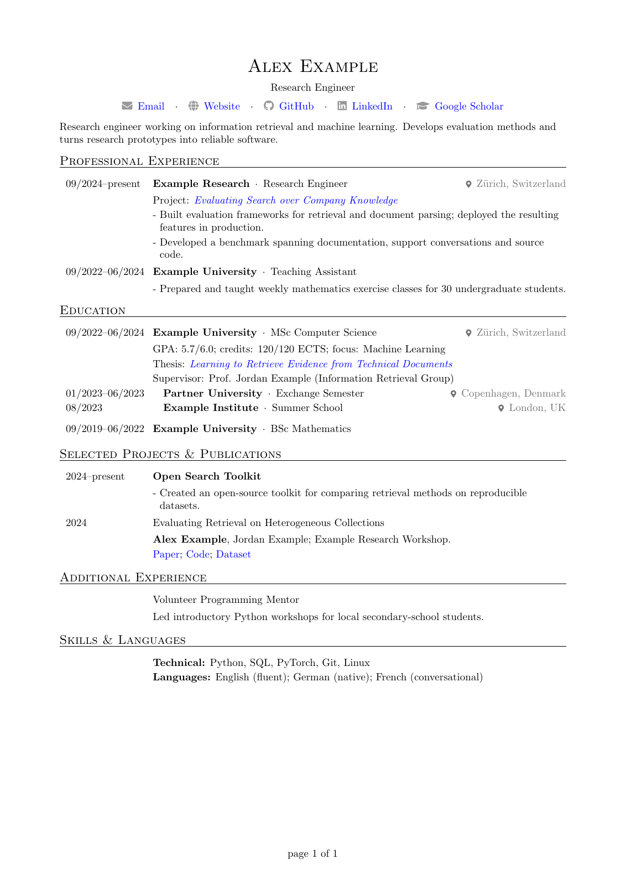

# LaTeX CV Template

[](cv-example.pdf)

## Compile online with Overleaf

No installation needed.

1. Download this repository using **Code → Download ZIP**.
2. In [Overleaf](https://www.overleaf.com), choose **New Project → Upload Project** and upload the ZIP.
3. Open `cv-example.tex`. Select it as the main document and use **pdfLaTeX** as the compiler if needed.
4. Click **Recompile**, then download the PDF.

## Compile on your computer

Install [MacTeX](https://tug.org/mactex/) on macOS or [TeX Live](https://tug.org/texlive/quickinstall.html) on Windows or Linux. A full installation includes the required packages.

Download and extract this repository. Keep `cv-example.tex` and `cv.cls` in the same folder, open a terminal there, and run:

```sh
latexmk -pdf cv-example.tex
```

This generates `cv-example.pdf`. Run the command again after editing.

To remove temporary build files while keeping the PDF:

```sh
latexmk -c cv-example.tex
```
